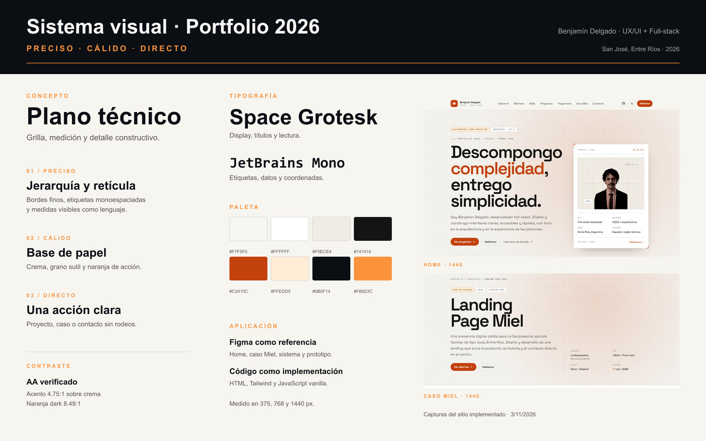

# Portfolio 2026 — Benjamín Delgado

Portfolio personal de **Benjamín Delgado**, desarrollador full-stack y diseñador UX/UI de Entre Ríos, Argentina. Reúne proyectos, trayectoria, contacto y el caso de estudio de la **Landing Page Miel** para La Sanjosesina.

**Práctica Final · Diseño UX/UI 2026**  
Mg. Ernesto Ledesma · Entrega: 10/11/2026



## Estado y enlaces

- **Repositorio:** [github.com/Benjamin-mne/UX](https://github.com/Benjamin-mne/UX) · rama `tpf`
- **Diseño de referencia:** [Figma — Benjamín Delgado Portfolio](https://www.figma.com/design/oRORWy5E6sjLgGccQSy7OH/Benjam%C3%ADn-Delgado-Portfolio)
- **Caso Miel publicado:** [lasanjosesina.com](https://www.lasanjosesina.com/)
- **GitHub:** [Benjamin-mne](https://github.com/Benjamin-mne)
- **LinkedIn:** [Benjamín Delgado](https://www.linkedin.com/in/benjam%C3%ADn-delgado-a51728228/)
- **Email:** [benjamindelgado.contacto@gmail.com](mailto:benjamindelgado.contacto@gmail.com)
- **Deploy del portfolio:** pendiente de importación en Vercel. La URL anterior no corresponde a esta versión.

El sitio está implementado. Falta publicar esta rama en Vercel, actualizar la URL final en metadata y ejecutar el test de usabilidad con personas.

## El problema

Un portfolio para desarrolladores suele caer en dos extremos: una lista de tecnologías sin criterio o una sucesión de pantallas sin contexto. La consigna pedía algo más completo: identidad propia, navegación clara, responsive, accesibilidad, performance y un caso de estudio que muestre proceso.

La hipótesis de diseño fue:

> Si el sitio explica en pocos segundos **quién soy, qué construyo y cómo trabajo**, el visitante puede decidir si quiere ver proyectos o contactarme sin recorrer una arquitectura innecesaria.

Objetivos concretos:

1. Presentar el perfil y la propuesta de valor en el primer viewport.
2. Mostrar cuatro proyectos con rol, stack y resultado.
3. Documentar el caso Miel de principio a fin.
4. Sostener una experiencia consistente en 375, 768 y 1440 px.
5. Cumplir WCAG 2.2 AA en estructura, foco, contraste y teclado.
6. Medir performance mobile con Lighthouse ≥ 90.
7. Cerrar con un contacto directo, sin formularios que agreguen fricción.

## Público objetivo

Definido a priori, no a partir de entrevistas:

- **Reclutadores técnicos:** necesitan escanear rol, stack, proyectos y contacto.
- **Clientes freelance:** buscan evidencia de criterio, ejecución y casos reales.
- **Pares y docentes:** evalúan proceso, decisiones, accesibilidad y calidad de implementación.

El sitio prioriza lectura rápida, jerarquía explícita y enlaces de contacto visibles.

## Research y benchmark

Se revisaron tres referencias reales para detectar patrones, no para copiar interfaces:

| Referencia | Qué funciona | Qué se tomó |
| --- | --- | --- |
| [Brittany Chiang](https://brittanychiang.com/) | One-page con navegación lateral, jerarquía estricta y foco en proyectos. | Escaneabilidad, anclas y contenido antes que decoración. |
| [Josh Comeau](https://www.joshwcomeau.com/) | Personalidad fuerte, microinteracciones y profundidad técnica. | Voz propia y detalle en estados interactivos. |
| [Maggie Appleton](https://maggieappleton.com/) | Identidad ilustrada, textura y ritmo editorial. | Calidez visual y exploración sin competir con la lectura. |

**Decisiones derivadas:**

- Una home one-page con anclas claras.
- Un caso de estudio separado para profundizar sin sobrecargar la home.
- Identidad técnica con textura de papel, grilla y medición.
- Movimiento discreto: revelar jerarquía, no decorar.
- Contenido real y resultados verificables antes que métricas inventadas.

## Arquitectura de información

### Home

1. Header sticky con navegación, GitHub, tema y menú mobile.
2. Hero: propuesta, disponibilidad, retrato y stack.
3. Métricas: proyectos, años, tecnologías y áreas de foco.
4. Skills: front-end, back-end y producto.
5. Proyectos: caso Miel destacado + tres proyectos.
6. Trayectoria: experiencia y formación.
7. Sobre mí: perfil, principios y enlaces.
8. Contacto: email, WhatsApp del caso, GitHub y LinkedIn.
9. Footer con navegación secundaria.

### Caso de estudio

1. Contexto y ficha del proyecto.
2. Objetivos.
3. Proceso: research, arquitectura, diseño, build y QA.
4. Sistema visual y tokens.
5. Solución: bloques de la landing.
6. Resultados y alcance.
7. Aprendizajes.
8. Otros proyectos: Comparsa, Espacios de Trabajo y fisiks2D.

## Identidad y sistema visual

Concepto: **“plano técnico”**. La interfaz usa grillas, marcas de medición, tipografía monoespaciada y acentos naranjas sobre una base cálida. El objetivo es transmitir precisión sin volver el sitio frío.

Palabras guía: **preciso, cálido, directo**.

### Tipografía

- **Space Grotesk:** títulos, lectura y navegación.
- **JetBrains Mono:** etiquetas, datos, coordenadas y metadatos.
- Ambas self-hosted en WOFF2, con `font-display: swap` y `preload`.

### Tokens

| Token | Light | Dark |
| --- | --- | --- |
| Fondo | `#F7F5F0` | `#0B0F14` |
| Superficie | `#FFFFFF` | `#161B22` |
| Superficie 2 | `#F0ECE4` | `#11161D` |
| Texto | `#141414` | `#F5F5F4` |
| Texto secundario | `#57534E` | `#A8A29E` |
| Borde | `#D6D3D1` | `#2D333B` |
| Acento | `#C2410C` | `#FB923C` |
| Acento suave | `#FFEDD5` | `#FDBA74` |

Contraste verificado:

- `#C2410C` sobre `#F7F5F0`: **4.75:1**
- Blanco sobre `#C2410C`: **5.18:1**
- `#FB923C` sobre `#0B0F14`: **8.49:1**
- `#57534E` sobre `#F7F5F0`: **7.00:1**
- `#A8A29E` sobre `#0B0F14`: **7.62:1**

### Componentes y estados

- `Button / Primary` y `Button / Ghost`.
- `Tag / Accent` y etiquetas de metadatos.
- Campo de email y botón de copiado.
- Header sticky, menú mobile, tema claro/oscuro.
- Estados hover, focus-visible, disabled y active.
- Reveal al entrar en viewport, desactivado con `prefers-reduced-motion`.

El diseño parte del Figma oficial del portfolio. La paleta violeta del ejercicio base se reemplazó por una escala naranja validada por contraste. El sitio completa las secciones que el archivo de referencia no cubría: métricas, trayectoria, sobre mí y contacto.

## Implementación

- **HTML5 semántico**, sin frameworks de UI.
- **Tailwind CSS 3.4** compilado y minificado con Tailwind CLI.
- **JavaScript vanilla** para tema, menú, reveal, navegación activa, copiado de email y año dinámico.
- **Sharp** para generar Open Graph e iconos PNG.
- **Vercel** como destino de deploy estático.

Decisiones técnicas:

- CSS propio compilado: sin runtime de utilidades en producción.
- Fuentes locales: sin requests a Google Fonts.
- Imágenes con `width`, `height`, `loading` y `decoding` explícitos.
- SVG propios para wireframes y sistema visual.
- Metadata social y JSON-LD por página.
- Sin analytics: no se reportan conversiones.

## Accesibilidad

- Un solo `h1` por página y jerarquía de encabezados.
- HTML semántico: `header`, `nav`, `main`, `section`, `article`, `footer`.
- Skip link y foco visible en todos los interactivos.
- Menú mobile con `aria-expanded`, `aria-controls`, cierre con Escape y foco gestionado.
- Navegación con `aria-current`.
- Imágenes con texto alternativo; SVG decorativos con `aria-hidden`.
- Targets táctiles de al menos 44 px.
- Tema claro/oscuro persistido en `localStorage`.
- Respeto por `prefers-reduced-motion`.
- Contraste textual verificado.
- Lighthouse Accessibility: **100** en home y caso, mobile y desktop.

## Performance y evidencia

Lighthouse 12.8.2 local, Edge headless, `serve@14`, medición sobre `http://localhost:4173`:

| Página | Performance | Accessibility | Best practices | SEO |
| --- | ---: | ---: | ---: | ---: |
| Home mobile | 97 | 100 | 100 | 100 |
| Caso Miel mobile | 100 | 100 | 100 | 100 |
| Home desktop | 85 | 100 | 100 | 100 |

Métricas mobile de la home:

- FCP: 0.8 s
- LCP: 2.6 s
- TBT: 10 ms
- CLS: 0
- Speed Index: 0.8 s

Los reportes completos están en [`docs/lighthouse/`](docs/lighthouse/). Son mediciones locales, no una garantía de producción. Deben repetirse sobre la URL final de Vercel.

### Capturas y comparativas

- [`docs/captures/`](docs/captures/): home y caso en 375, 768 y 1440, light/dark; 404 en 375 y 1440 light.
- [`docs/captures/README.md`](docs/captures/README.md): inventario, método y métricas de captura.
- [`docs/captures/comparativas/`](docs/captures/comparativas/): Figma vs. implementación.
- [`docs/captures/figma/`](docs/captures/figma/): exports de los frames de referencia.
- [`docs/captures/capture-metrics.json`](docs/captures/capture-metrics.json): ancho, alto, overflow y `h1` por captura.

En las 14 capturas: un solo `h1`, sin overflow horizontal y sin imágenes pendientes.

## Caso de estudio: Landing Page Miel

**Cliente:** La Sanjosesina / Apícola Las Marías  
**Rol:** UX/UI + Front-end  
**Stack:** Astro + Tailwind  
**Estado:** publicado en [lasanjosesina.com](https://www.lasanjosesina.com/)

La Sanjosesina es una empresa familiar con más de 40 años en San José, Entre Ríos. Produce miel, propóleo e hidromiel, y exporta parte de su producción. El desafío era trasladar esa trayectoria a una landing clara, cálida y directa.

### Objetivos

- Explicar la marca sin perder profundidad.
- Mostrar seis variedades con formato, precio y descripción.
- Reducir la fricción de contacto con WhatsApp.
- Sostener la experiencia en mobile.

### Proceso

1. **Research:** referencias del rubro, marcas de miel y productores locales.
2. **Arquitectura:** hero, productos, historia, confianza y contacto.
3. **Wireframes:** estructura y jerarquía antes de color.
4. **Sistema visual:** crema, miel y ámbar; texto marrón profundo.
5. **Build:** Astro + Tailwind, componentes reutilizables y SEO técnico.
6. **QA:** responsive, jerarquía de encabezados, foco visible y enlaces.

### Resultado

Una sola página con el producto al frente, la historia de la marca y contacto directo por WhatsApp. Sin e-commerce innecesario y sin formularios que agreguen pasos.

No se incluyen métricas de conversión porque el proyecto no tuvo instrumentación analítica.

## Proyectos

| Proyecto | Año | Rol | Stack | Resultado |
| --- | ---: | --- | --- | --- |
| [Landing Page Miel](caso-estudio.html) | 2026 | UX/UI + Front-end | Astro, Tailwind, SEO | Landing publicada con contacto directo por WhatsApp. |
| Comparsa de Carnaval | 2023 | Full-stack | React, Redux, Express, MongoDB | Inscripciones, PDFs y correos en un solo flujo. |
| Espacios de Trabajo | 2023 | Full-stack | Node.js, Socket.io | Tablero colaborativo en tiempo real. |
| fisiks2D | 2024 | Front-end / Open source | TypeScript, Canvas, Vitest | Motor de física 2D con colisiones AABB y tests. |

Los wireframes de Comparsa, Espacios y fisiks2D son representaciones propias de estructura y jerarquía, no capturas de los productos reales. El caso Miel usa un wireframe basado en la landing publicada.

## Estructura

```text
.
├── index.html                  # Home one-page
├── caso-estudio.html           # Caso Miel + otros proyectos
├── 404.html
├── src/
│   └── input.css               # Tokens, dark mode y componentes
├── dist/
│   └── styles.css              # CSS compilado
├── js/
│   └── main.js                 # Interacciones vanilla
├── assets/
│   ├── fonts/                  # Space Grotesk + JetBrains Mono
│   └── img/                    # SVG, OG, iconos y retrato optimizado
├── scripts/
│   └── generate-og.js          # Open Graph e iconos con Sharp
├── docs/
│   ├── captures/               # Evidencia visual y comparativas
│   ├── lighthouse/             # Reportes y resumen
│   ├── proceso-portfolio-2026.html
│   └── proceso-portfolio-2026.pdf
├── tailwind.config.js
├── vercel.json
├── robots.txt
├── sitemap.xml
├── site.webmanifest
└── README.md
```

## Cómo ejecutar

Requisitos: Node.js 18+ y npm.

```bash
npm install
npm run build
npx --yes serve@14 . -l 4173
```

Abrir `http://localhost:4173`.

Scripts:

```bash
npm run dev         # Tailwind en modo watch
npm run build       # compila y minifica dist/styles.css
npm run generate:og # regenera OG e iconos PNG
```

## Deploy en Vercel

1. Importar `Benjamin-mne/UX` en Vercel.
2. Seleccionar la rama `tpf`.
3. Framework preset: **Other**.
4. Root directory: `.`.
5. Install command: `npm ci`.
6. Build command: `npm run build`.
7. Output directory: `.`.

El `vercel.json` incluye headers de seguridad y cache para assets. Después del deploy:

- Actualizar `canonical`, `og:url`, `og:image`, JSON-LD, `sitemap.xml` y `robots.txt`.
- Repetir Lighthouse sobre la URL de producción.
- Revisar que `/`, `/caso-estudio.html` y `/404.html` respondan correctamente.

## Proceso y documentación

- **Deck de proceso:** [`docs/proceso-portfolio-2026.pdf`](docs/proceso-portfolio-2026.pdf) (10 slides).
- **Fuente editable:** [`docs/proceso-portfolio-2026.html`](docs/proceso-portfolio-2026.html).
- **Capturas:** [`docs/captures/`](docs/captures/).
- **Lighthouse:** [`docs/lighthouse/`](docs/lighthouse/).

## Limitaciones y pendientes

- **Deploy del portfolio:** pendiente de importación en Vercel. No hay URL final de esta versión.
- **Metadata:** `canonical`, Open Graph, JSON-LD, sitemap y robots todavía apuntan al dominio anterior hasta que exista la URL nueva.
- **Test de usabilidad:** no ejecutado. No hay participantes, hallazgos ni tasas de éxito. No se inventaron resultados.
- **Revisión visual manual:** pendiente de inspección final en navegador y Figma.
- **Proyectos secundarios:** Comparsa, Espacios y fisiks2D usan wireframes; no incluyen capturas reales ni repositorios públicos en esta entrega.
- **Analytics:** sin instrumentación; no se reportan conversiones.

## Uso de IA

Se utilizó asistencia de IA para ordenar la estructura, redactar borradores, generar evidencia visual y acelerar la implementación. Las decisiones de diseño, el contenido y el código fueron revisados y ajustados por el autor. Los datos de performance son mediciones reales; el test con personas no se ejecutó y no se simula.

## Créditos y licencias

- Diseño y desarrollo: Benjamín Delgado.
- Space Grotesk y JetBrains Mono: SIL Open Font License 1.1. Licencias en `assets/fonts/`.
- Wireframes, sistema visual y composiciones: producción propia.
- La Sanjosesina / Apícola Las Marías: contenido público de la marca para el caso de estudio.
