# Cubrí · Contratación digital de seguros

Prototipo funcional de checkout para seguros de celular, construido con **Vite + HTML5 + Tailwind CSS v4 + Basecoat UI + JavaScript vanilla**. No requiere backend: la cotización, el pago y la emisión de la póliza se simulan en el navegador.

## Demo local

```bash
npm install
npm run dev
```

Abrir `http://localhost:5173`.

**Sitio publicado:** _(completar con la URL de GitHub Pages, Netlify o Firebase Hosting)._

## Scripts

| Comando | Descripción |
| --- | --- |
| `npm run dev` | Servidor de desarrollo con HMR. |
| `npm run build` | Genera la versión de producción en `dist/`. |
| `npm run preview` | Sirve la build de producción localmente. |

## Flujo implementado

1. **Inicio**: hero, productos disponibles y CTA de cotización.
2. **Cotizar**: marca, modelo, valor y antigüedad del equipo.
3. **Elegir plan**: Básico, Plus y Premium con coberturas y precios calculados.
4. **Datos personales**: nombre, apellido, DNI, nacimiento, email, celular y términos.
5. **Pago**: método de pago, tarjeta, vencimiento, CVV y titular.
6. **Éxito**: confirmación, número de póliza y descarga del comprobante.
7. **Error de pago**: mensaje de rechazo, reintento y cambio de método.

El resumen de compra se actualiza en cada paso y permite volver a editar los datos ingresados.

## Capturas

| Pantalla | Mobile (390) | Desktop (1440) |
| --- | --- | --- |
| 01 · Inicio | 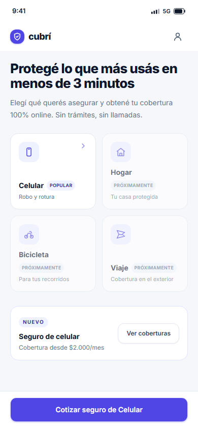 | 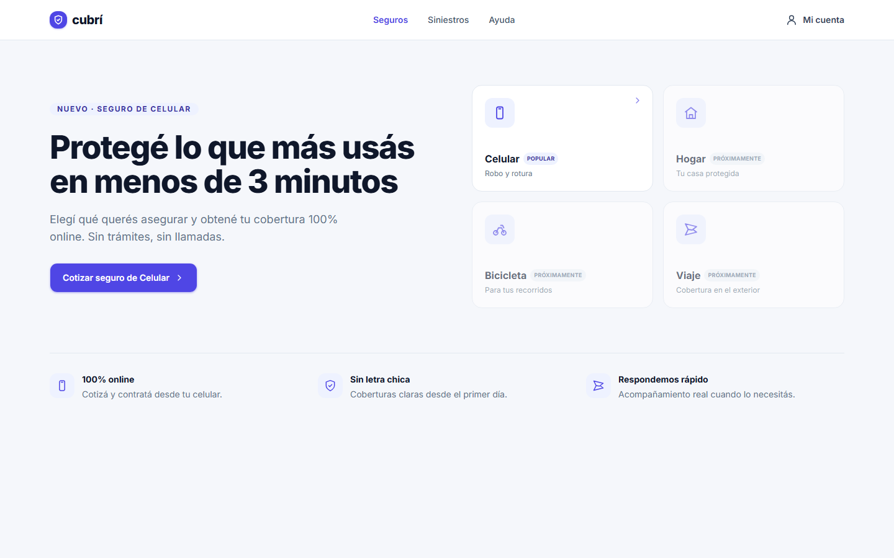 |
| 02 · Cotizar | 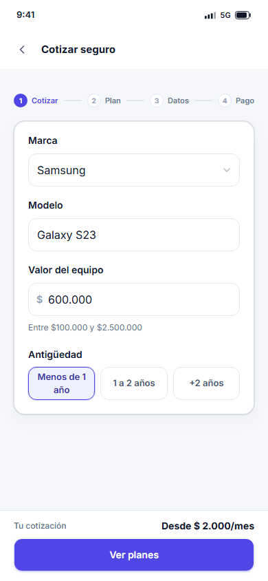 | 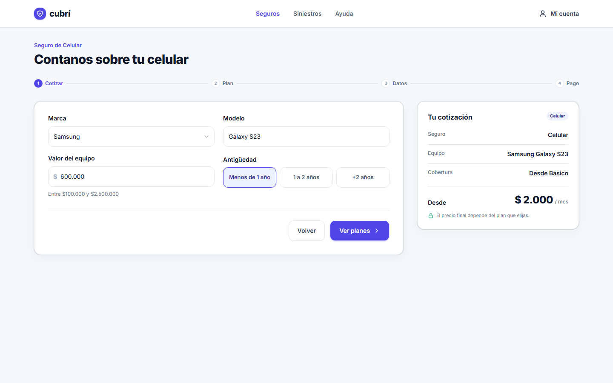 |
| 03 · Elegir plan | 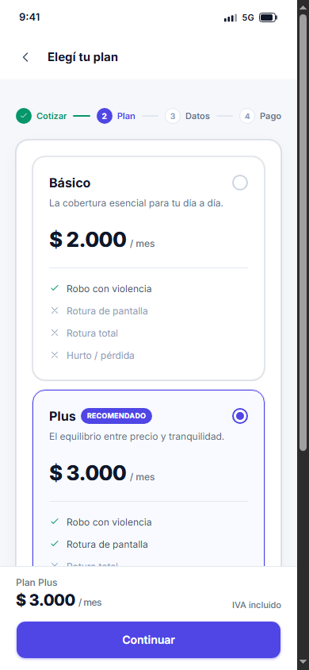 | 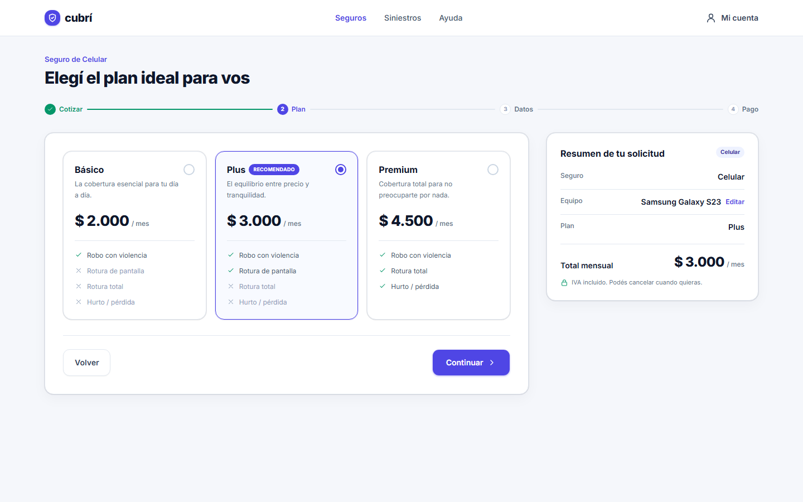 |
| 04 · Datos personales | 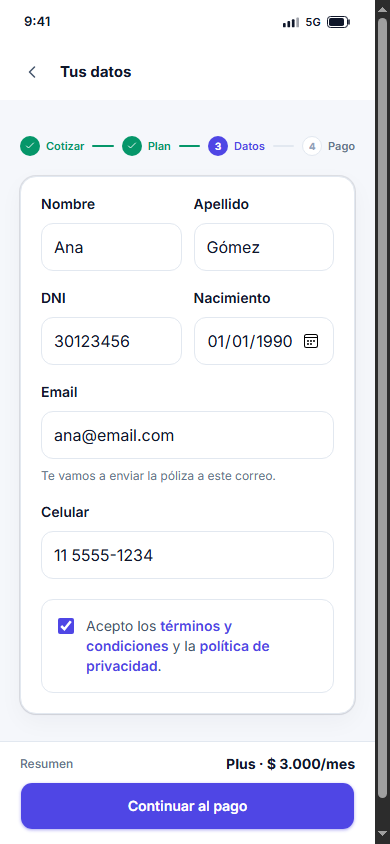 | 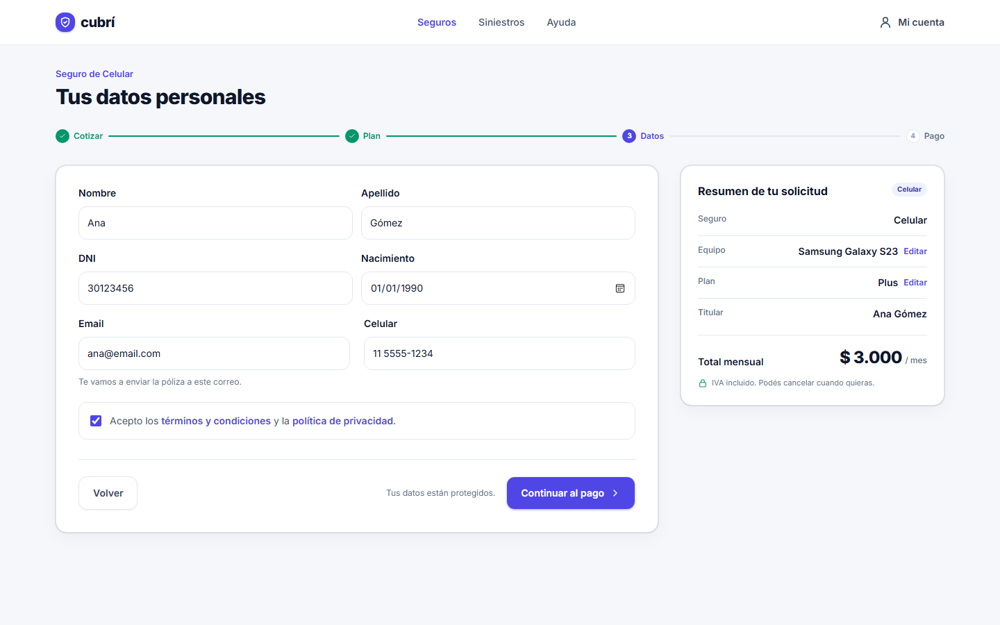 |
| 05 · Pago | 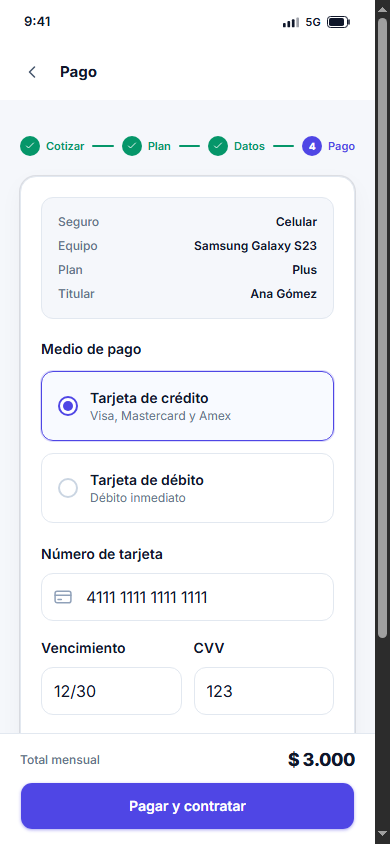 | 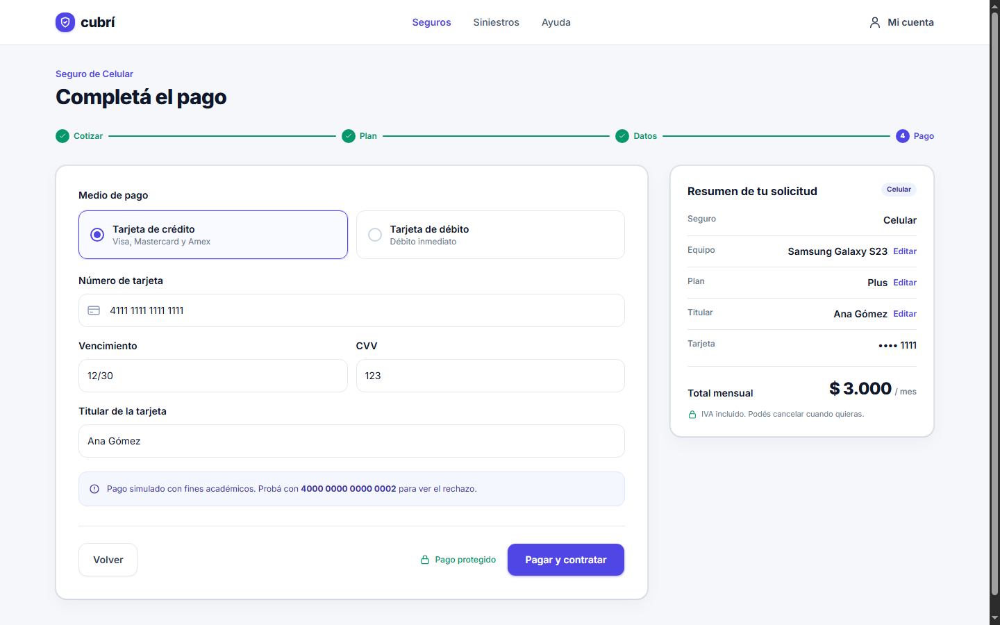 |
| 06 · Éxito | 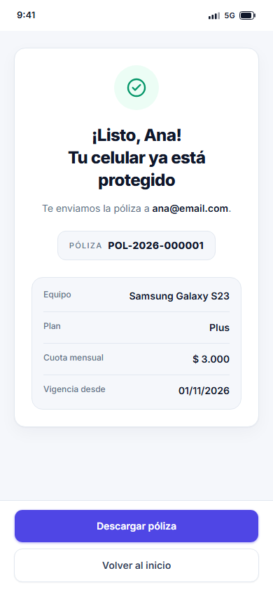 | 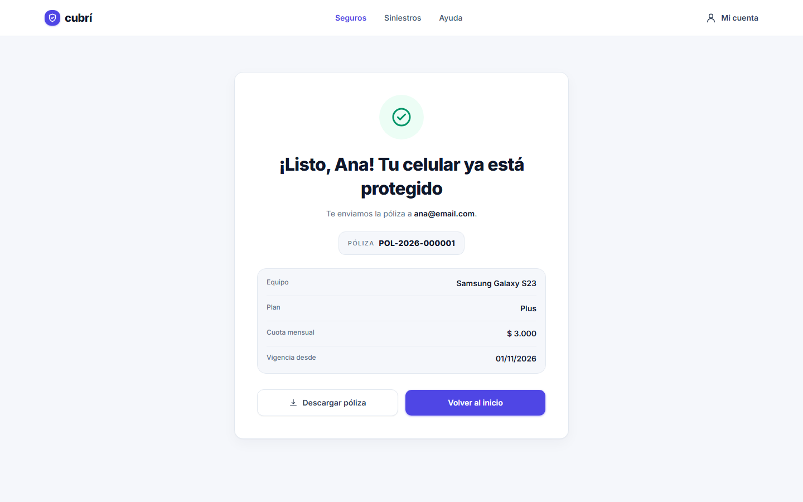 |
| 07 · Error de pago | 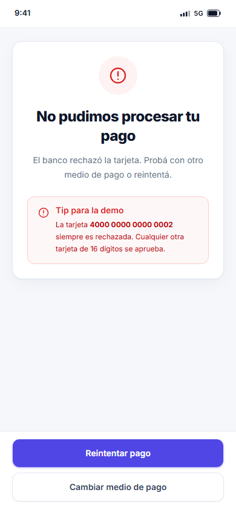 | 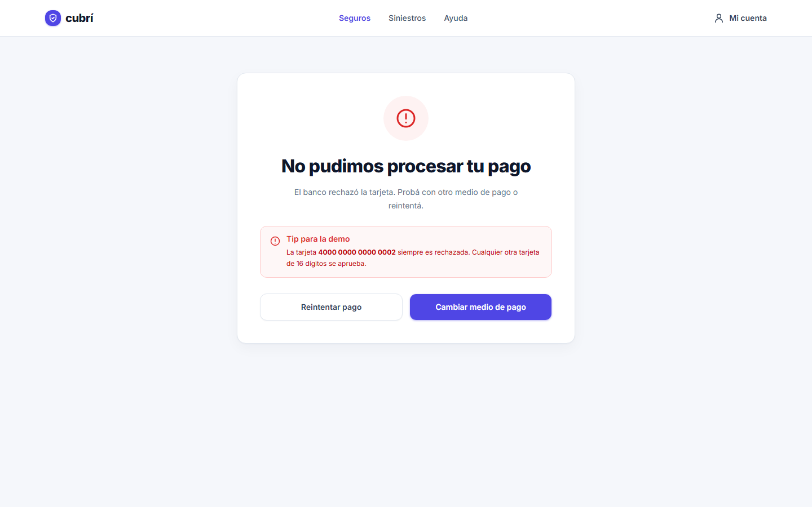 |

## Lógica de negocio

### Cotización

La cuota mensual se calcula con:

```js
Math.round((valor * tasaAnual) / 12 * factorAntiguedad)
```

Factores de antigüedad:

- Menos de 1 año: `1.00`
- Entre 1 y 2 años: `1.10`
- Más de 2 años: `1.25`

Casos verificados:

| Valor | Antigüedad | Básico | Plus | Premium |
| --- | --- | ---: | ---: | ---: |
| $600.000 | < 1 año | $2.000 | $3.000 | $4.500 |
| $600.000 | 1–2 años | $2.200 | $3.300 | $4.950 |
| $1.200.000 | > 2 años | $5.000 | $7.500 | $11.250 |

### Pago simulado

- La simulación demora 1,5 segundos.
- Se aprueba cualquier tarjeta, excepto `4000 0000 0000 0002`.
- La póliza se genera con el formato `POL-AAAA-NNNNNN`.
- Al reintentar después de un rechazo se conservan los datos del paso 4.

## Validaciones

- Campos obligatorios y mensajes de error por campo.
- Valor del equipo entre `$100.000` y `$2.500.000`.
- Modelo de 2 a 40 caracteres.
- DNI de 7 u 8 dígitos.
- Edad mínima de 18 años.
- Email y celular con formato válido.
- Aceptación de términos y condiciones.
- Tarjeta de 16 dígitos, vencimiento futuro y CVV de 3 dígitos.
- Botones de avance deshabilitados hasta que el paso sea válido.

También se aplican máscaras de entrada para celular, DNI, vencimiento, CVV y tarjeta.

## Persistencia y bonus

**Bonus implementados**

- Persistencia en `localStorage` para sobrevivir a un F5; se limpia al completar la contratación.
- Enlaces “Editar” en el resumen para volver al paso correspondiente y regresar al pago.
- Máscaras de entrada para tarjeta, vencimiento, CVV, DNI y celular.
- Setup con Vite + npm y build relativa para publicar en GitHub Pages o subdirectorio.

**No implementados**

- Toast de Basecoat al confirmar el pago.
- Habilitar Bicicleta o Viaje con otra tabla de tasas.
- Modo oscuro y deploy automático con GitHub Actions.

**Extras**

- Descarga del comprobante de la póliza en texto plano.

## Estructura

```text
.
├── index.html              # Shell de la SPA y las 7 pantallas
├── vite.config.js          # Vite + Tailwind, base relativa para GitHub Pages
├── public/
│   ├── data/planes.json    # Planes, precios y coberturas
│   └── favicon.svg
└── src/
    ├── main.js             # Inicialización, eventos, máscaras y navegación
    ├── estado.js           # Estado global y persistencia
    ├── render.js           # Renderizado del DOM y resumen
    ├── validaciones.js     # Reglas y mensajes de validación
    ├── cotizador.js        # Cálculo de cuotas y formato de moneda
    ├── pago.js             # Simulación de pago y póliza
    ├── icons.js            # Iconos SVG inline
    ├── style.css           # Tailwind, Basecoat y componentes propios
    └── tokens.css          # Tokens de color, tipografía y radios
```

## Decisiones técnicas

- **JavaScript vanilla + JSDoc**: el alcance no justifica un framework; se mantiene el DOM explícito y liviano.
- **Tailwind CSS v4 + Basecoat**: botones `.btn` con variantes `outline` y `ghost`, campos `.field`, cards, badges y alerts de Basecoat, con overrides acotados para respetar el diseño de Figma.
- **Diseño responsive**: layouts específicos para mobile (`390px`) y desktop (`1440px`), con footer fijo en mobile y formularios de 2 columnas en desktop.
- **Accesibilidad**: foco visible, etiquetas asociadas, `aria-invalid`, `aria-describedby`, errores con `role="alert"`, foco automático en el primer campo inválido y navegación por teclado.
- **Sin backend**: no se envían datos reales; todo el flujo es una simulación educativa.

## Deploy

La build usa `base: './'`, por lo que puede publicarse en GitHub Pages o en cualquier subdirectorio:

```bash
npm run build
```

Luego publicar el contenido de `dist/`.

## Limitaciones

- Los pagos y las pólizas son simulados.
- No hay autenticación, base de datos ni integración con pasarelas de pago.
- Los datos personales ingresados quedan únicamente en el navegador.
